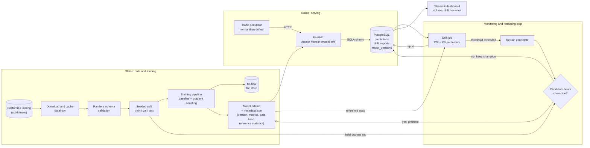
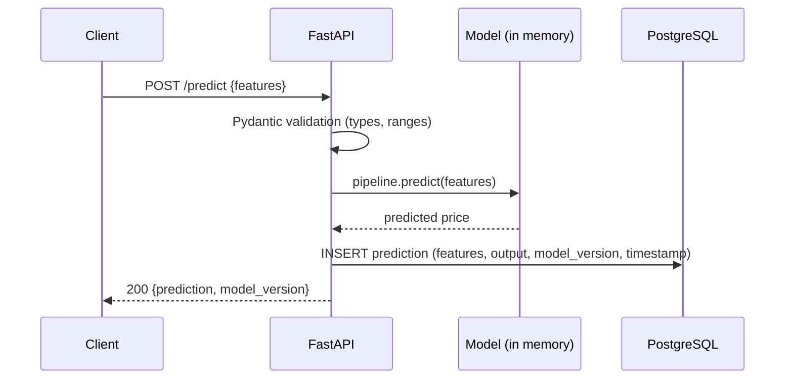

# Architecture

## Goal

A house price prediction service (regression on the scikit-learn California Housing
dataset) that is observable and self-correcting: every prediction is logged, incoming
data is compared against the training distribution, and when drift is detected a
candidate model is trained and promoted only if it beats the current one on a
held-out test set.

The project is a portfolio piece. It demonstrates ML engineering (reproducible data
and training pipelines, experiment tracking, model quality gates), testing
(unit, integration, property-based, model quality) and DevOps (Docker, Compose,
GitHub Actions).

## Components

| Component | Technology | Responsibility |
|---|---|---|
| Data layer | pandas, Pandera | Download and cache the dataset, validate its schema, produce a seeded train/validation/test split |
| Training pipeline | scikit-learn, MLflow (file store) | Baseline and gradient boosting pipelines, metrics, artifact and metadata files with reference feature statistics |
| API | FastAPI, Pydantic | `/health`, `/predict`, `/model-info`; validates requests and logs every prediction |
| Prediction store | PostgreSQL, SQLAlchemy | Persists prediction requests, drift reports and model version history |
| Drift job | numpy, scipy | Compares recent requests against reference statistics with PSI and the KS test; writes a drift report |
| Retraining | scikit-learn, MLflow | Triggered by drift; trains a candidate and promotes it only if it beats the champion on the test set |
| Traffic simulator | httpx | Sends normal then gradually drifted requests to demonstrate the full loop |
| Dashboard | Streamlit, plotly | Prediction volume, per-feature drift, model version history |
| CI/CD | GitHub Actions, Docker | Lint, tests against a PostgreSQL service, train-and-quality-gate, Docker build, manual retraining workflow |

## System diagram



## Request flow for a prediction



## Key design decisions

- **Reproducibility over cleverness.** A fixed seed drives the split and the models.
  The metadata file records a hash of the training data so a model can always be
  traced to the exact rows it saw.
- **Reference statistics live with the model.** Drift is measured against the data
  the deployed model was trained on, not against a global constant. Promoting a new
  model therefore also updates the drift baseline.
- **Promotion gate on the held-out test set.** The test split is never used for
  training or model selection, so beating the champion on it is meaningful evidence.
- **PostgreSQL for everything operational.** Predictions, drift reports and version
  history share one database, which keeps the dashboard and the drift job simple.
- **MLflow file store, not a tracking server.** One fewer service to run; the
  tracking directory is enough for a single-developer portfolio and for CI.
- **Unit tests never touch the network.** The dataset is downloaded once by a
  script; tests use small synthetic frames built in fixtures.

## Repository layout

```
.
├── .github/workflows/     CI and retraining workflows
├── docs/                  architecture and per-phase notes
├── src/housing_mlops/     installable package
│   ├── config.py          settings from environment / .env
│   ├── data/              download, schema, split          (phase 1)
│   ├── training/          pipelines, metrics, metadata     (phase 2)
│   ├── api/               FastAPI app, schemas, db models  (phase 3)
│   ├── monitoring/        PSI, KS, drift job               (phase 4)
│   ├── dashboard/         Streamlit app                    (phase 4)
│   └── retraining/        candidate training, promotion   (phase 5)
├── scripts/               CLI entry points (download, train, simulate, drift)
├── tests/
│   ├── unit/              fast, offline
│   └── integration/       API against PostgreSQL
├── data/                  cached dataset (gitignored)
├── models/                artifacts and metadata (gitignored)
├── mlruns/                MLflow file store (gitignored)
├── pyproject.toml         dependencies (pinned), ruff, pytest, coverage
├── Dockerfile             multi-stage, non-root           (phase 3)
└── docker-compose.yml     api, db, dashboard              (phase 3)
```

## Phases

| Phase | Branch | Deliverable |
|---|---|---|
| 0 | `feat/phase-0-setup` | Scaffold, this document, minimal CI |
| 1 | `feat/phase-1-data` | Download, schema, split, data tests |
| 2 | `feat/phase-2-training` | Pipelines, MLflow, metadata, model quality tests |
| 3 | `feat/phase-3-api` | FastAPI, PostgreSQL logging, Docker, Compose |
| 4 | `feat/phase-4-monitoring` | Drift job, simulator, dashboard |
| 5 | `feat/phase-5-retraining` | Promotion gate, full CI workflows |
| 6 | `feat/phase-6-readme` | README with real results, cleanup |
